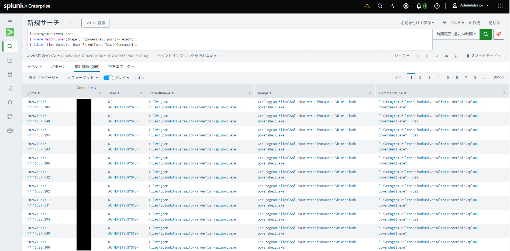
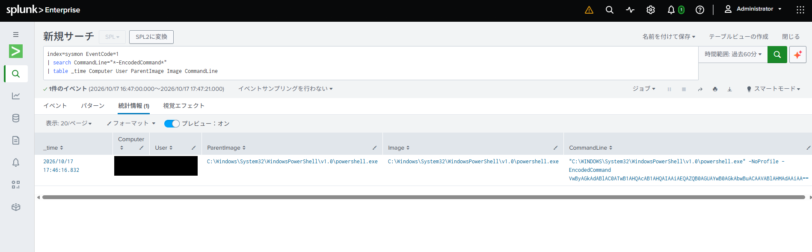
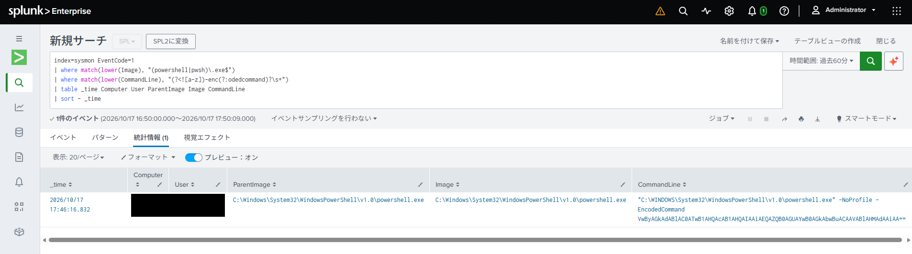
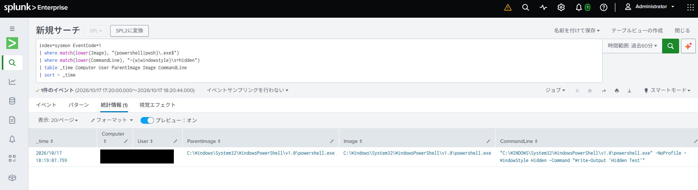
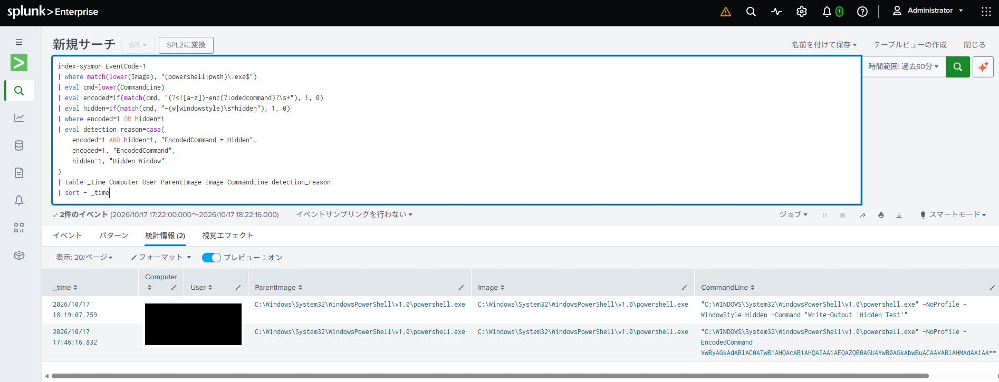
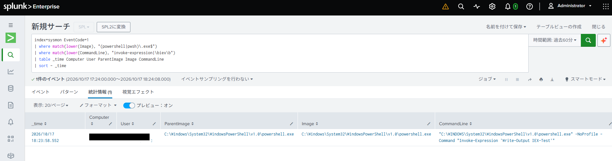
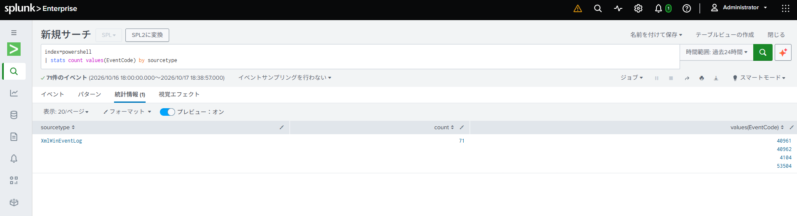
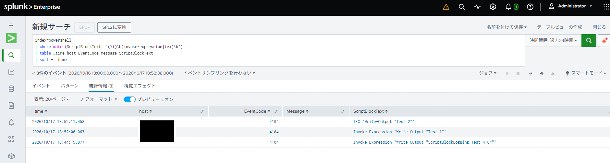
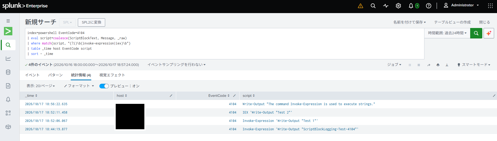

# Splunk Detection Engineering

# Suspicious PowerShell Execution Detection

## 1. Overview

PowerShell is a powerful command-line and scripting tool widely used for Windows administration and automation. However, its capabilities can also be abused by attackers to execute malicious commands, download and run scripts, and perform post-exploitation activities.

Because PowerShell is a legitimate Windows tool, attackers may use it to blend malicious activity with normal system operations. This technique is often associated with *Living off the Land (LotL)*, where attackers abuse legitimate tools already available in the environment.

This detection focuses on identifying potentially suspicious PowerShell execution patterns using Sysmon Event ID 1 (Process Creation) and PowerShell Event ID 4104 (Script Block Logging) collected in Splunk Enterprise.

The detection targets the following behaviors:

- **Encoded commands (`-EncodedCommand`):** Attackers may use Base64-encoded commands to obscure the contents of PowerShell commands and make them more difficult to recognize through simple command-line inspection.
- **Dynamic code execution (`Invoke-Expression` / `IEX`):** Attackers may use these commands to execute dynamically generated or downloaded PowerShell code, including malicious payloads.
- **Hidden execution (`-WindowStyle Hidden`):** Attackers may use this parameter to execute PowerShell without displaying a visible console window, reducing the likelihood of attracting user attention.

These behaviors may indicate suspicious activity, but they are also used in legitimate administrative tasks and automation.

The objective of this detection is to identify potentially suspicious PowerShell activity for further investigation, understand the visibility and limitations of different log sources, and improve detection accuracy through testing and tuning rather than classify every matching event as malicious.

## 2. Required Data Source

- **Data source:** Sysmon
- **Event ID:** 1 (Process Creation)
- **SIEM:** Splunk Enterprise
- **Index:** `sysmon`
- **Key fields:** `Image`, `CommandLine`, `ParentImage`, `User`, `Computer`

## 3. Detection Logic

The initial detection rule focuses on identifying PowerShell processes launched with the `-EncodedCommand` parameter.

The rule uses Sysmon Event ID 1 (Process Creation) and examines the process image and command-line arguments.

```spl
index=sysmon EventCode=1
| where match(lower(Image), "(powershell|pwsh)\.exe$")
| where match(lower(CommandLine), "(?<![a-z])-enc(?:odedcommand)?\s+")
| table _time Computer User ParentImage Image CommandLine
| sort - _time
```

This rule is intended to identify potentially suspicious PowerShell executions for further investigation. The use of `-EncodedCommand` alone does not necessarily indicate malicious activity.

## 4. Test Procedure and Results

### 4.1 Test Procedure

I executed a harmless PowerShell command using the `-EncodedCommand` parameter to generate a test event.

```powershell
$command = 'Write-Output "Detection Test"'
$encoded = [Convert]::ToBase64String(
    [Text.Encoding]::Unicode.GetBytes($command)
)

powershell.exe -NoProfile -EncodedCommand $encoded
```

I also executed a normal PowerShell command without the `-EncodedCommand` parameter to compare the results.

```powershell
powershell.exe -NoProfile -Command "Write-Output 'Normal Test'"
```

#### 4.2 Test Results

**01. PowerShell Process Creation Log Verification**

Verified that PowerShell process creation events were successfully collected through Sysmon Event ID 1 and could be searched in Splunk Enterprise.



**02. Encoded PowerShell Command Detection**

Confirmed that the detection rule successfully identified PowerShell execution using the `-EncodedCommand` parameter.



**03. Detection Validation with Normal PowerShell Execution**

Confirmed that the normal PowerShell execution did not match the detection rule, while the encoded command execution remained visible in the search results.



### 4.3 Hidden PowerShell Execution Detection

This test focused on detecting PowerShell processes launched with the `-WindowStyle Hidden` parameter using Sysmon Event ID 1.

The following command was executed to generate a test event:

```powershell
powershell.exe -NoProfile -WindowStyle Hidden -Command "Write-Output 'Hidden Test'"
```

The execution was successfully recorded in Sysmon and detected in Splunk Enterprise.



The detection logic was then extended to identify both `-EncodedCommand` and `-WindowStyle Hidden` execution patterns.

The combined detection rule successfully identified both test scenarios and displayed the corresponding detection reason.



These parameters can also be used in legitimate administrative operations. Therefore, matching events should be treated as potentially suspicious rather than automatically classified as malicious.

### 4.4 Invoke-Expression Detection Using Sysmon Event ID 1

This test evaluated whether `Invoke-Expression` could be detected using Sysmon process creation events.

Two execution scenarios were tested.

**Scenario 1: Execution through a new PowerShell process**

```powershell
powershell.exe -NoProfile -Command "Invoke-Expression 'Write-Output IEX-Test'"
```

The command was successfully detected because `Invoke-Expression` was included in the process command line recorded by Sysmon Event ID 1.



**Scenario 2: Execution within an existing PowerShell session**

```powershell
Invoke-Expression 'Write-Output "Interactive IEX Test"'
```

In this scenario, no new PowerShell process was created. Therefore, the command execution was not captured as a new Sysmon Event ID 1 event.


This test demonstrated that process creation logging alone is insufficient for monitoring commands executed within an existing PowerShell session.

### 4.5 PowerShell Script Block Logging Integration

To improve visibility into PowerShell execution, Script Block Logging was enabled on the Windows endpoint.

PowerShell Script Block Logging records script block content in Event ID 4104 under the following Windows Event Log channel:

`Microsoft-Windows-PowerShell/Operational`

The Splunk Universal Forwarder was configured to collect these events and forward them to Splunk Enterprise.

The events were stored in the `powershell` index.

The following configuration was added to `inputs.conf`:

```ini
[WinEventLog://Microsoft-Windows-PowerShell/Operational]
disabled = 0
index = powershell
renderXml = true
```

After enabling logging and configuring log forwarding, Event ID 4104 was successfully verified in both Windows Event Viewer and Splunk Enterprise.



This provided additional visibility into PowerShell commands executed within an existing session.

### 4.6 Invoke-Expression Detection Using Event ID 4104

A detection rule was created to identify references to `Invoke-Expression` and its alias `IEX` in PowerShell Script Block Logging events.

The following commands were executed within an existing PowerShell session:

```powershell
Invoke-Expression 'Write-Output "Test-1"'
```

```powershell
IEX 'Write-Output "Test-2"'
```

Both test scenarios were successfully detected in Splunk Enterprise using Event ID 4104.



A normal PowerShell command without these keywords was also executed to verify that it did not match the detection conditions.

```powershell
Write-Output "Normal-ScriptBlock-Test"
```

The test demonstrated that Script Block Logging provides visibility into PowerShell code that cannot be fully observed through Sysmon process creation events alone.

### 4.7 False Positive Validation

An additional test was performed to evaluate the limitations of keyword-based detection.

The following command was executed:

```powershell
Write-Output "The command Invoke-Expression is used to execute strings."
```

Although `Invoke-Expression` was not actually executed, the event matched the detection rule because the keyword appeared within a string literal.



This demonstrated that keyword-based detection cannot reliably distinguish actual command execution from references to suspicious commands.

The detection was also refined to explicitly target PowerShell Event ID 4104, ensuring that the rule focused on the intended log source.

However, restricting the event ID did not eliminate the keyword-based false positive.

## 5. False Positives and Limitations

### 5.1 Legitimate PowerShell Activity

The use of `-EncodedCommand`, `-WindowStyle Hidden`, or `Invoke-Expression` does not necessarily indicate malicious activity.

These features may also be used by legitimate administrative scripts, automation tools, and software management processes.

Detection results therefore require additional investigation and contextual analysis.

### 5.2 Limitations of Sysmon Event ID 1

Sysmon Event ID 1 records process creation information, including the command line used to launch a process.

However, it does not provide complete visibility into commands executed later within an existing PowerShell session.

PowerShell Script Block Logging (Event ID 4104) can help address this visibility gap.

### 5.3 Limitations of Keyword-Based Detection

The initial Event ID 4104 detection rule identifies suspicious keywords within logged script block content.

However, it may also match keywords appearing in comments or string literals, even when the corresponding commands are not executed.

Additionally, simple keyword matching may fail to detect alternative execution techniques or obfuscated commands.

### 5.4 Potential Improvements

Future improvements may include:

- Combining multiple suspicious behaviors to increase detection confidence.
- Correlating Sysmon process creation events with PowerShell Script Block Logging events.
- Analyzing legitimate administrative activity to identify common false positives.
- Evaluating syntax-aware detection techniques instead of relying exclusively on keyword matching.
- Developing Sigma rules to represent detection logic in a SIEM-independent format.

## 6. Findings and Lessons Learned

Through this exercise, I developed and validated detection rules for suspicious PowerShell execution patterns using Splunk Enterprise.

The key findings were:

1. **Process creation monitoring:** Sysmon Event ID 1 can identify suspicious PowerShell startup parameters, such as `-EncodedCommand` and `-WindowStyle Hidden`.
2. **Telemetry limitations:** Sysmon Event ID 1 cannot provide complete visibility into commands executed within an existing PowerShell session.
3. **Additional logging:** PowerShell Script Block Logging (Event ID 4104) improves visibility into PowerShell script execution.
4. **Detection validation:** Both positive and negative test cases are important for evaluating detection behavior.
5. **False positive analysis:** Keyword-based detection may identify suspicious strings without confirming that the corresponding commands were executed.

This exercise highlighted the importance of selecting appropriate log sources, understanding detection limitations, and validating detection logic through controlled testing.

Future work will focus on improving detection accuracy, correlating multiple log sources, and converting detection logic into Sigma rules.

## 7. Final Detection Rule

### 7.1 Overview

Based on the detection tests and validation results, a consolidated SPL query was developed to identify potentially suspicious PowerShell execution patterns.

The rule combines two log sources:

- **Sysmon Event ID 1 (Process Creation):** Detects PowerShell processes launched with suspicious command-line parameters.
- **PowerShell Event ID 4104 (Script Block Logging):** Detects references to `Invoke-Expression` and its alias `IEX` within PowerShell script blocks.

The detection covers three behaviors: encoded command execution, hidden PowerShell execution, and dynamic code execution using `Invoke-Expression` or `IEX`.

### 7.2 Consolidated SPL Query

```spl
(index=sysmon EventCode=1) OR (index=powershell EventCode=4104)
| eval log_source=case(
    index="sysmon", "Sysmon Event ID 1",
    index="powershell", "PowerShell Event ID 4104"
)
| eval cmd=case(
    index="sysmon", coalesce(CommandLine, ""),
    index="powershell", coalesce(ScriptBlockText, Message, _raw)
)
| eval encoded=if(
    index="sysmon" AND match(cmd, "(?i)(?<![a-z])-enc(?:odedcommand)?\s+"),
    1, 0
)
| eval hidden=if(
    index="sysmon" AND match(cmd, "(?i)-(?:w|windowstyle)\s+hidden\b"),
    1, 0
)
| eval iex=if(
    match(cmd, "(?i)\b(?:invoke-expression|iex)\b"),
    1, 0
)
| where encoded=1 OR hidden=1 OR iex=1
| eval detection_reason=mvappend(
    if(encoded=1, "EncodedCommand", null()),
    if(hidden=1, "Hidden Window", null()),
    if(iex=1, "Invoke-Expression / IEX", null())
)
| eval detection_reason=mvjoin(detection_reason, ", ")
| table _time host log_source User Image ParentImage cmd detection_reason
| sort - _time
```

### 7.3 Detection Logic

The consolidated rule identifies suspicious PowerShell activity based on the following conditions:

| Detection Type | Log Source | Detection Condition |
|---|---|---|
| Encoded Command Execution | Sysmon Event ID 1 | PowerShell launched with `-EncodedCommand` or `-enc` |
| Hidden PowerShell Execution | Sysmon Event ID 1 | PowerShell launched with `-WindowStyle Hidden` or `-w Hidden` |
| Invoke-Expression Execution | Sysmon Event ID 1 / PowerShell Event ID 4104 | Command line or script block contains `Invoke-Expression` or `IEX` |

The `detection_reason` field indicates which detection conditions were matched, allowing analysts to quickly understand why an event was flagged.

### 7.4 Limitations and Future Improvements

This rule is an initial consolidated detection designed for a controlled lab environment.

The following limitations remain:

- Keyword-based detection may generate false positives when suspicious terms appear in comments or string literals.
- Legitimate administrative operations may use the same PowerShell parameters.
- The rule does not cover every possible PowerShell parameter abbreviation or obfuscation technique.
- Events from Sysmon and PowerShell Script Block Logging are combined into a single result set but are not yet correlated by process identity.

Future improvements will focus on detection tuning, process-level correlation, and Sigma rule development.
