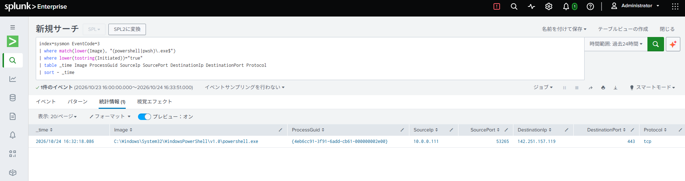
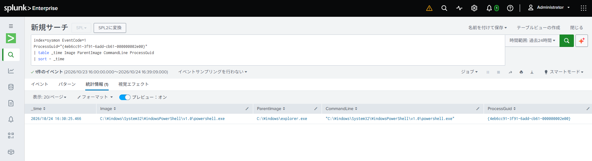
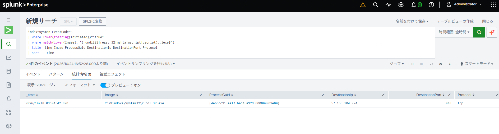
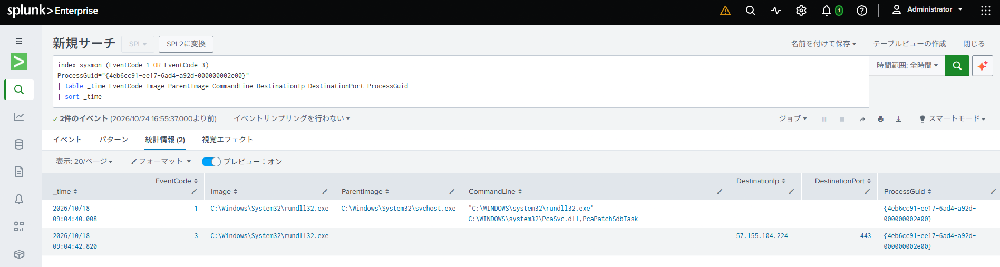
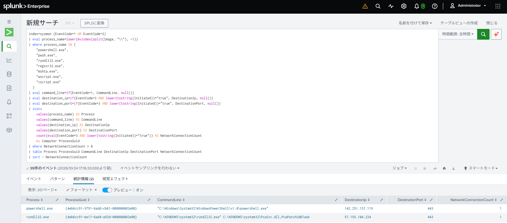

# Network Activity Monitoring for Suspicious Processes

## Overview

Investigated network connections using Sysmon Event ID 3 to identify potentially suspicious outbound network activity.

Focused on PowerShell, `rundll32.exe`, `regsvr32.exe`, `mshta.exe`, `wscript.exe`, and `cscript.exe` because these legitimate Windows tools can be abused by attackers to execute malicious code, download payloads, or communicate with external servers.

Monitoring network connections from these processes can help identify suspicious activity associated with Living off the Land (LotL) techniques.

## Findings

### 1. Network Connection Monitoring

- Confirmed that Sysmon Event ID 3 records outbound network connections.
- Verified that destination IP addresses, ports, and process information can be identified.

### 2. PowerShell Network Activity (Test)

Executed the following command to generate a test HTTPS connection to Google:

```powershell
Invoke-WebRequest -Uri "https://www.google.com" -UseBasicParsing
```

Successfully detected the connection in Splunk using Sysmon Event ID 3.

```text
Image: C:\Windows\System32\WindowsPowerShell\v1.0\powershell.exe
SourceIp: 10.0.0.111
DestinationIp: 142.251.157.119
DestinationPort: 443
Protocol: tcp
ProcessGuid: {4eb6cc91-3f91-6add-cb61-000000002e00}
```



Next, searched Sysmon Event ID 1 using the ProcessGuid obtained from Event ID 3.



This demonstrated how network connection events can be correlated with process creation events to investigate the process's command line and parent process.

### 3. Suspicious Process Network Activity

Searched for network connections initiated by `rundll32.exe`, `regsvr32.exe`, `mshta.exe`, `wscript.exe`, and `cscript.exe`.

Detected a connection from `rundll32.exe` and correlated Sysmon Event ID 1 and Event ID 3 using `ProcessGuid`.

```text
ParentImage: C:\Windows\System32\svchost.exe
CommandLine: rundll32.exe C:\WINDOWS\system32\PcaSvc.dll,PcaPatchSdbTask
DestinationIp: 57.155.104.224
DestinationPort: 443
```



The execution appeared to be related to a legitimate Windows compatibility function.

This was considered a likely false positive rather than confirmed malicious activity.

## Lessons Learned

### ProcessId vs. ProcessGuid

- **ProcessId (PID):** Assigned by Windows and can be reused after a process terminates.
- **ProcessGuid:** Generated by Sysmon to identify a process across different Sysmon events.

Using `ProcessGuid` makes it easier to correlate process creation (Event ID 1) with network connections (Event ID 3).

For correlation between Sysmon and other Windows event logs, different identifiers may be required.

| Events | Correlation |
|---|---|
| Sysmon ID 1 ↔ ID 3 | ProcessGuid |
| Sysmon ID 1 ↔ ID 7 / ID 11 | ProcessGuid |
| Sysmon ID 1 ↔ PowerShell ID 4104 | Computer + ProcessId + Time |

PowerShell Event ID 4104 does not contain Sysmon's ProcessGuid.

## Detection SPL

The following query detects outbound network connections from PowerShell and selected Windows processes, and correlates them with process creation events to retrieve the command line.

```spl
index=sysmon (EventCode=1 OR EventCode=3)
| eval process_name=lower(mvindex(split(Image, "\\"), -1))
| where process_name IN (
    "powershell.exe",
    "pwsh.exe",
    "rundll32.exe",
    "regsvr32.exe",
    "mshta.exe",
    "wscript.exe",
    "cscript.exe"
  )
| eval command_line=if(EventCode=1, CommandLine, null())
| eval destination_ip=if(EventCode=3 AND lower(tostring(Initiated))="true", DestinationIp, null())
| eval destination_port=if(EventCode=3 AND lower(tostring(Initiated))="true", DestinationPort, null())
| stats
    values(process_name) AS Process
    values(command_line) AS CommandLine
    values(destination_ip) AS DestinationIp
    values(destination_port) AS DestinationPort
    count(eval(EventCode=3 AND lower(tostring(Initiated))="true")) AS NetworkConnectionCount
    by Computer ProcessGuid
| where NetworkConnectionCount > 0
| table Process ProcessGuid CommandLine DestinationIp DestinationPort NetworkConnectionCount
| sort - NetworkConnectionCount
```

**Note:** Network activity from these processes is not necessarily malicious. Additional investigation of command-line arguments, parent processes, and destinations is required.
