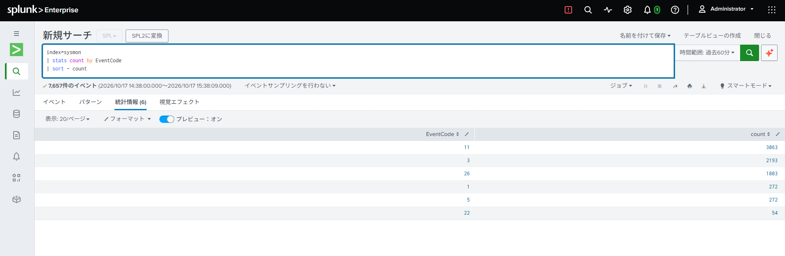
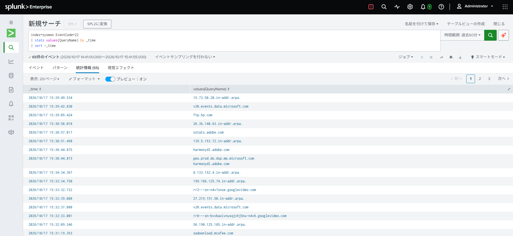

# Sysmon Monitoring

## 1. Objective
Learn how to collect and analyze Windows system activity using Sysmon.

## 2. Environment
- Windows
- Sysmon
- Splunk(running on a VM)

## 3. Implementation

### 3.1 Lab Architecture

I built a Windows security monitoring lab using Sysmon and Splunk to collect and analyze Windows system events.

The environment consists of the following components:

| Component | Role |
|---|---|
| Windows 11 | Endpoint being monitored |
| Sysmon | Collection of Windows system activity events |
| Splunk Universal Forwarder | Forwarding Windows event logs to Splunk |
| Splunk Enterprise | Centralized log storage, search, and analysis |
| Ubuntu VM | Hosting Splunk Enterprise |

The Ubuntu virtual machine was created using VirtualBox.

The VM was configured with NAT networking for external connectivity and a host-only network for communication between the Windows host and the VM.

### 3.2 Sysmon Installation and Configuration

I installed Sysmon on the Windows endpoint to collect detailed system activity logs.

Sysmon records events such as process creation, network connections, and DNS queries, depending on the configured rules.

For this lab, I used the following Windows Event Log channel:

`Microsoft-Windows-Sysmon/Operational`

The initial approach was to forward all Sysmon events to Splunk and perform event filtering and analysis on the Splunk side.

This approach allowed me to examine the available event types before deciding which events should be prioritized or excluded.

After several rounds of tuning, I finalized the Sysmon configuration.<br>
The final Sysmon configuration is available here:

[View Sysmon Configuration](../configs/sysmon-config.xml)


### 3.3 Splunk Enterprise Setup

I installed Splunk Enterprise on a virtual machine to build a centralized log analysis platform.

I followed the official Splunk documentation for the installation procedure :

https://help.splunk.com/en/splunk-enterprise/get-started/search-tutorial/9.3/part-1-getting-started/install-splunk-enterprise#id_0b0731b9_7ad0_4d56_8948_82c25ebc7105--en__Linux_installation_instructions

- Dedicated service account: I configured Splunk Enterprise to run under a dedicated non-root user to follow the principle of least privilege.

### 3.4 Splunk Universal Forwarder Configuration
I installed Splunk Universal Forwarder on a Windows machine from which I wanted to collect logs.

I followed the official Splunk documentation for the installation procedure :

https://help.splunk.com/en/splunk-cloud-platform/forward-and-process-data/universal-forwarder-manual/10.6/install-the-universal-forwarder/install-a-windows-universal-forwarder#a19ec22d_68d3_4a7f_b41c_456267545717--en__Install_a_Windows_universal_forwarder_from_an_installer

I configured Splunk Universal Forwarder on the Windows endpoint to collect Sysmon event logs and forward them to Splunk Enterprise.

Splunk Universal Forwarder provides a straightforward way to collect and forward Sysmon logs because it supports Windows Event Log collection natively.

The following configuration was used in `inputs.conf`:

```ini
[WinEventLog://Microsoft-Windows-Sysmon/Operational]
renderXml = true
index = sysmon
```

The `renderXml = true` setting enables XML-formatted Windows Event Log collection.

The `index = sysmon` setting specifies the destination index for Sysmon events.

The collected events were forwarded to the Splunk Enterprise instance.

### 3.5 Log Collection and Analysis

The monitoring workflow was designed as follows:

1. Sysmon monitors system activity on the Windows endpoint.
2. Sysmon writes events to the Windows Event Log.
3. Splunk Universal Forwarder collects events from the Sysmon Operational channel.
4. The events are forwarded to Splunk Enterprise.
5. Splunk stores the events in the `sysmon` index for searching and analysis.

The following SPL query can be used to inspect the collected events:

```spl
index=sysmon
| stats count by EventCode
| sort - count
```

This query summarizes the number of collected events by event ID and helps identify which event types generate the most data.



Another useful sample query for investigating DNS activity is:

```spl
index=sysmon EventCode=22 
| stats values(QueryName) by _time
| sort -_time
```

This query displays the domains resolved by Sysmon DNS queries, along with their timestamps.



## 4. Findings and Lessons Learned
### 4.1 Sysmon Configuration Tuning

One of the most challenging aspects of this project was tuning the Sysmon configuration.

Initially, Sysmon generated a large volume of logs, and it took more time than I expected to identify which events were necessary and which could be excluded.

Through this process, I learned that collecting more security events does not necessarily lead to more effective monitoring.

I also realized that the events worth collecting depend on what I want to detect. Therefore, it is important to define clear detection objectives before deciding which events to collect or exclude.

This experience taught me the importance of balancing log visibility, event volume, and detection requirements, as well as continuously reviewing and refining logging configurations based on monitoring objectives.

### 4.2 File Deletion Monitoring (Event ID 23 vs. 26)

During this project, I learned that Sysmon Event IDs 23 and 26 behave differently when monitoring file deletion.

Event ID 23 archives deleted files in addition to logging deletion events, which can lead to unexpected disk space consumption.

While using my PC for everyday tasks, I noticed that my C: drive was almost full. After investigating the issue, I discovered that Sysmon had been silently accumulating archived files generated by Event ID 23, consuming a significant amount of disk space without my knowledge.

In contrast, Event ID 26 logs file deletion events without archiving the deleted files.

To resolve this issue, I changed the Sysmon configuration to use Event ID 26 instead of Event ID 23.

This experience taught me that security monitoring configurations can have unintended consequences on everyday system operations, even when no active testing is being performed. It highlighted the importance of considering resource consumption and operational impact when designing and maintaining monitoring systems.

For this lab, I determined that Event ID 26 was more appropriate because my objective was to monitor file deletion activity rather than preserve deleted files.

This experience taught me the importance of understanding not only what an event records, but also how enabling it affects system resources and operations.

### 4.3 DNS Query Visibility Limitation

During preliminary testing for domain-based IoC detection, I found that some DNS queries generated by Microsoft Edge were not recorded in Sysmon Event ID 22, even though the queries were successfully captured in Wireshark with Secure DNS disabled.

Further investigation confirmed that Edge used DNS over HTTPS (DoH) when Secure DNS was enabled. However, disabling DoH did not resolve the missing Sysmon events.

These findings indicate that Sysmon Event ID 22 alone may not provide complete visibility into DNS queries generated by applications.

For detailed investigation steps and results, see [DNS Visibility Investigation](dns-visibility-investigation.md).
